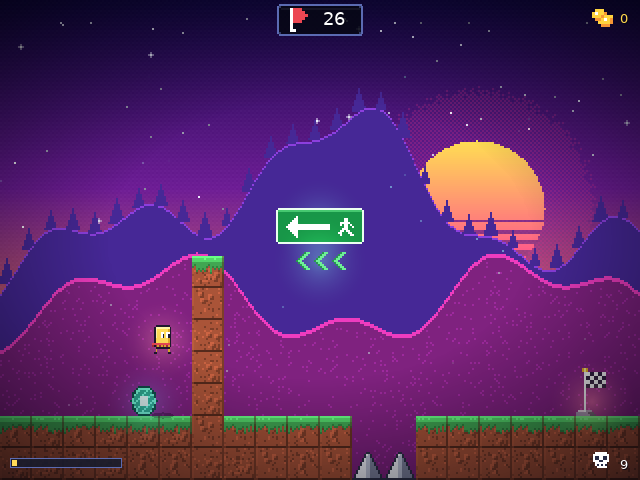

# Devil's Detour

Every level lies to you. A pixel-art trick platformer for handheld Linux devices (PortMaster), written in C with SDL2.



- 550 levels in 11 worlds. Every 10th level is a trick screen.
- Each level makes 8-13 claims about itself ("the exit is on the left", "the spikes are fake"). Most are lies. Press R1 for the icon guide, which also shows what lied in the last level.
- Signs point the wrong way, some flags kill, controls and floor change with a clock, and some levels are blocked by a wall that only a lucky gate can throw you past (touch it at the wrong moment and it kills you, so try again).
- Every platform level is proven finishable by a built-in solver that tracks the clock.
- All art is generated procedurally at start-up, no image assets.

Tested target: Anbernic RG34XX SP (720x480) and RG35XX Pro (640x480) on muOS. Any aarch64 PortMaster device with SDL2 should work.

## Controls

| Button | Action |
|--|--|
| D-pad / Left stick | Move |
| A / B / X / Y | Jump |
| R1 | Icon guide |
| Start | Pause (Select while paused: back to menu) |
| Start + Select (hold 1 s) | Quit |

After 8 deaths on a level, Select skips it. Progress is saved in `save.txt` next to the binary.

## Install (muOS / PortMaster)

Copy `Devils Detour.sh` to `ROMS/Ports/` and the `devilsdetour/` folder to `ports/` on the SD card. The files in `portmaster/` are the launcher and metadata used for the PortMaster submission.

## Build

Needs only SDL2 headers (`apt install libsdl2-dev`) and Python.

Cross-compile for aarch64 (glibc 2.17, links against the device's own `libSDL2-2.0.so.0`):

```shell
pip install ziglang
./build_arm.sh        # -> out/arm/devilsdetour
```

Native test build (headless, no display needed):

```shell
gcc -O2 -DTRUST_TEST -Iinc -I/usr/include/SDL2 -Isrc src/trust.c src/font_data.c -o out/trust_test -lSDL2 -lm
SDL_VIDEODRIVER=dummy SDL_AUDIODRIVER=dummy ./out/trust_test --solve 1 550   # proves every level finishable
```

Other test options: `--dump`, `--stats`, `--fuzz`, `--overlap`, `--signstat`, `--shot mode level frames out.bmp`.

Layout: `src/` game, `inc/` SDL config stub for cross-compiling, `tools/` font and box-art generators, `art/` cover images, `portmaster/` launcher and metadata, `docs/` development notes and project history.

## License

MIT, see `LICENSE`. The embedded font is DejaVu, see `docs/LICENSE.dejavu-fonts.txt`.
